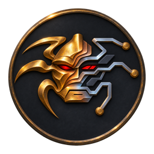
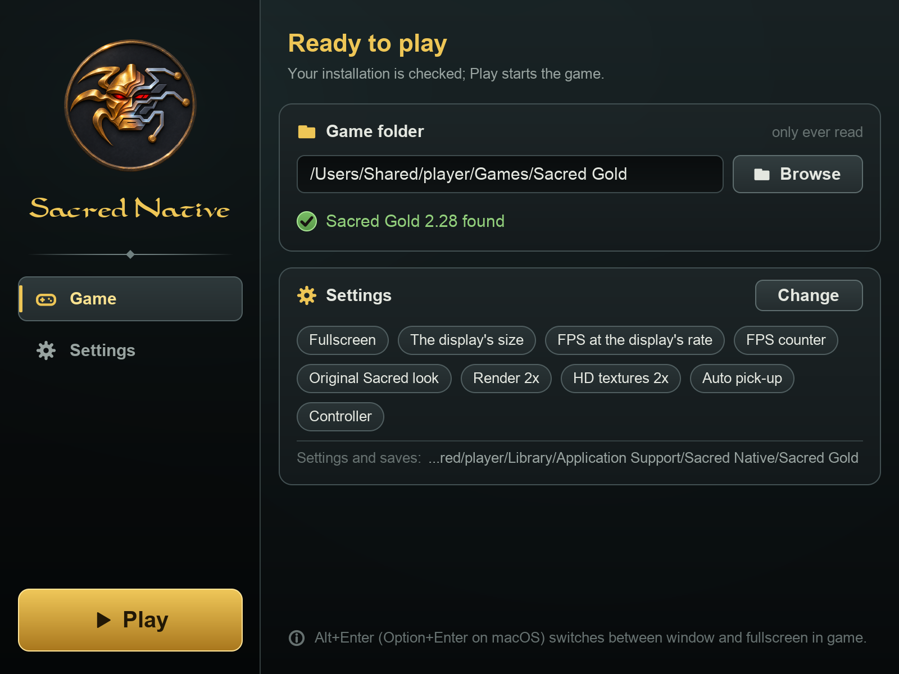

<p align="center">
  
</p>

<h1 align="center">Sacred Native</h1>

<p align="center">
  A native port of <b>Sacred Gold</b> for macOS on Apple Silicon and Linux ARM64.<br>
  Your own copy of the game, without Windows, Wine or an emulator, at any screen size and frame rate.
</p>

<p align="center">
  <a href="https://github.com/Drashi/sacred-native/releases/latest">Download</a> ·
  <a href="#download-and-play">Getting started</a> ·
  <a href="#hd-and-widescreen">HD and widescreen</a> ·
  <a href="CONTRIBUTING.md">Building from source</a> ·
  <a href="docs/ARCHITECTURE.md">How it works</a>
</p>

<p align="center">
  
</p>

This is an unofficial fan project. It is not affiliated with, endorsed by or connected to the owners of the Sacred
trademark or the game's original developers and publishers. "Sacred" is their trademark.

## Highlights

- **Native on your system:** a Mac app with its own icon and a Linux bundle with a desktop entry, both started from
  a launcher that finds and checks your installation.
- **Any resolution and wide screens**, sharper 3D rendering, upscaled textures and up to 240 FPS, with game speed
  unchanged.
- **Optional extras**, all off or switchable: the original Sacred look, automatic loot pick-up, game controller
  support.
- **No game files in the download:** the game is translated from your own installation on your machine.

## You need your own copy of the game

Sacred Native contains **no game code and no game data**. It needs an installed **Sacred Gold 2.28** (English, the
DRM-free GOG release; the Steam release has DRM): the folder that holds `Sacred.exe`, `granny.dll` and `tincat2.dll`.
On macOS or Linux you can copy that folder from a Windows installation. The installation is only read, never changed.

The Steam release is the same version, but its `Sacred.exe` is protected by Steam's DRM, which keeps the game code
encrypted, so Sacred Native cannot translate it.

On the first start the launcher translates the game's own `Sacred.exe`, `granny.dll` and `tincat2.dll` into native code
on your machine (a few minutes, once per update). What ships is the runtime that replaces Windows, DirectDraw/Direct3D,
the Miles sound system and DirectShow, and a translation recipe that lists where the game's instructions are, without
any byte of the game.

## Download and play

Download the bundle for your system from the [releases page](https://github.com/Drashi/sacred-native/releases).

### macOS (Apple Silicon, macOS 15 or newer)

1. Unpack `sacred-native-macos-arm64.zip` and drag **Sacred Native.app** to Applications.
2. Remove the download quarantine once (the app is signed ad hoc, not notarized):

   ```sh
   xattr -dr com.apple.quarantine "/Applications/Sacred Native.app"
   ```

3. Open **Sacred Native**. The compiler comes from Xcode's command line tools when they are installed, otherwise from
   the bundled Zig.

### Linux (ARM64)

1. Unpack the bundle anywhere and start `./sacred-launcher` in its folder.
2. Optional: `./install-desktop-entry.sh` adds Sacred Native with its icon to your desktop's application menu, for
   your user only. `--uninstall` removes it again; run it again after moving the folder.

### The launcher

The **Game** page finds your installation (or lets you pick its folder with **Browse**), checks that it is Sacred
Gold 2.28 and sums up your settings. **Play** starts the game. The first Play translates and builds the game module
with a progress bar; later starts are immediate. The **Settings** page holds the port's options, each with a line on
what it does, and writes a change into the profile's `Settings.cfg` at once.

From a terminal the same works with `sacred-gold "/path/to/Sacred Gold"`: `./sacred-gold` on Linux,
`"/Applications/Sacred Native.app/Contents/MacOS/sacred-gold"` on macOS.

### Where things live

|                          | macOS                                                 | Linux                                    |
| ------------------------ | ----------------------------------------------------- | ---------------------------------------- |
| Settings, saves and log  | `~/Library/Application Support/Sacred Native/Sacred Gold` | `~/.local/share/Sacred Native/Sacred Gold` |
| Translated game module   | `~/Library/Application Support/Sacred Native/game-module` | `~/.local/share/Sacred Native/game-module` |

The log is `sacred-native.log` in the profile folder.

## HD and widescreen

A new profile starts fullscreen at the display's size and refresh rate with sharper rendering and textures already on.

- **Any resolution.** The game runs at the window's or display's size instead of 1024x768, including wide screens.
  Menus and loading screens designed for 4:3 are scaled to the screen height; the main menu and character select extend
  their sky and water to the full width, and the bundle's menu pictures fill the sides of the other screens.
- **Render scale** (1-4x) draws the 3D scene at a multiple of the window size and filters it down.
- **HD textures** (2-4x) upscales the game's own textures in the background; texture packs can replace them.
- **Frame rate limit** up to 240 FPS, or the display's refresh rate. Movement and game logic keep their speed.
- **Original Sacred look**: the classic UI skin, menu art and menu music that Sacred Gold ships but does not use.

Alt+Enter (Option+Enter on macOS) switches between window and fullscreen while you play.

## Gameplay extras

- **Auto pick-up** (off by default): the hero picks up the loot it walks past, filtered by the game's own pick-up
  setting from the in-game Options.
- **Controller** (off by default) plays the game with a gamepad: the left stick walks, A attacks the nearest enemy in
  the stick's direction, the other buttons are combat arts, potions and windows; in menus, message boxes and NPC
  dialogs the D-pad jumps between the entries, and the inventory's tabs and windows have buttons of their own.

All options are keys in the profile's `Settings.cfg` too; the bundle's `README.md` lists them.

## Building from source

See [CONTRIBUTING.md](CONTRIBUTING.md). In short, with the game installed:

```sh
export SACRED_ASSETS="/path/to/Sacred Gold"
tools/build_macos_deps.sh                         # macOS only: SDL2, FreeType, pkg-config in build/
tools/bootstrap.sh                                # Python venv, LGPL FFmpeg, generated C
cmake -S . -B build/game -DSACRED_BUILD_GAME=ON && cmake --build build/game -j
build/game/sacred-native --assets "$SACRED_ASSETS"
```

`tools/dist/make_bundle.sh` builds the same bundle the releases carry: on macOS `dist/Sacred Native.app` and
`dist/sacred-native-macos-arm64.zip`.

## How it works

[docs/ARCHITECTURE.md](docs/ARCHITECTURE.md) describes the translator, the runtime and the CPU semantics. In short:
every x86 instruction of the game becomes a few lines of C over an explicit CPU state, compiled by your C compiler.
The x87 FPU keeps its 80-bit registers; the Windows, DirectDraw, Miles and COM APIs the game imports are implemented
natively on SDL2, OpenGL, FFmpeg and FreeType.

## License

Copyright (C) 2026 Sacred Native contributors.

Sacred Native is free software: you can redistribute it and/or modify it under the terms of the GNU General Public
License as published by the Free Software Foundation, either version 3 of the License, or (at your option) any later
version (`GPL-3.0-or-later`, full text in [LICENSE](LICENSE)). It is distributed in the hope that it will be useful,
but WITHOUT ANY WARRANTY. Third-party components keep their own licenses; they and the LGPL relinking notes are listed
in [THIRD_PARTY_NOTICES.md](THIRD_PARTY_NOTICES.md). The [logo](data/icons/README.md) is the project's own and
contains nothing of the game.
